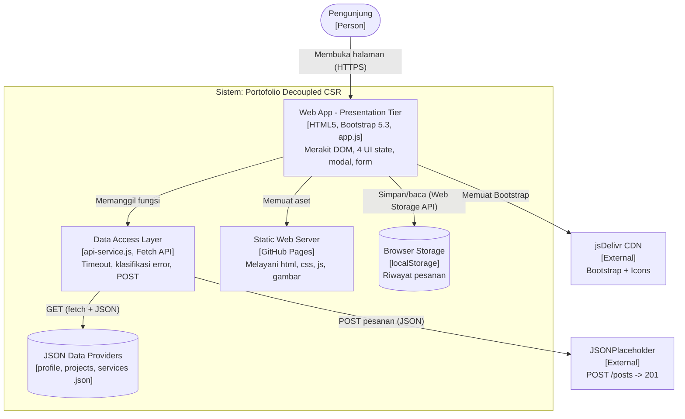
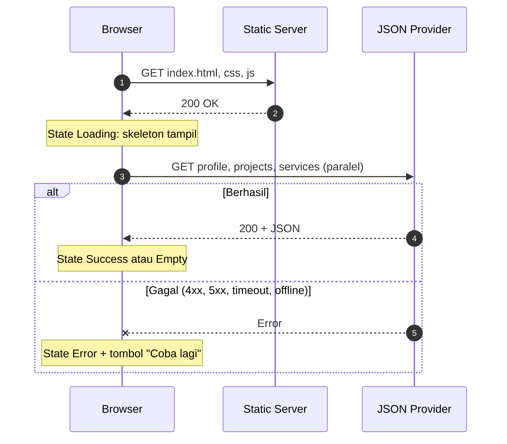

# Portofolio & Portal Layanan - Week 4: Decoupled Architecture & Dynamic CSR

Refactoring portofolio Week 3 (Bootstrap 5) menjadi aplikasi yang memuat seluruh kontennya secara asinkron dari penyedia data JSON, bukan lagi ditulis langsung di `index.html`.

**Pengembang:** Jody Alfonso Siahaan | **NIM:** 12S24039 | **Program Studi:** S1 Sistem Informasi
**Mata Kuliah:** Pemrograman dan Pengujian Web
**Live Demo:** https://[USERNAME-GITHUB-ANDA].github.io/ppw-2026-week4-12S24039/

## Struktur Direktori
```
.
├── index.html            # Shell HTML: hanya kerangka dan wadah kosong
├── custom-style.css      # Tema neon + skeleton loading
├── data/
│   ├── profile.json      # Biodata + daftar sertifikat
│   ├── projects.json     # Daftar proyek
│   └── services.json     # Katalog layanan (mengisi dropdown form)
├── js/
│   ├── api-service.js    # Data Access Layer: fetch, timeout, klasifikasi error, POST
│   └── app.js            # Presentation Layer: render DOM, event, UI state
└── docs/screenshots/     # Bukti DevTools (lihat bagian 6)
```

## 1. Arsitektur (C4 Container)



### Alur permintaan data


### Separation of Concerns
| Lapisan | Berkas | Tanggung jawab | Sengaja tidak dilakukan |
|---|---|---|---|
| Struktur | `index.html` | Kerangka semantik dan wadah (`#projects-container`, `#certificates-container`, satu modal) | Tidak berisi data proyek/sertifikat |
| Presentasi | `custom-style.css`, `js/app.js` | Gaya, merakit DOM, event, UI state | Tidak memanggil `fetch()` langsung |
| Akses data | `js/api-service.js` | URL, timeout, klasifikasi error, kontrak POST | Tidak menyentuh DOM |
| Data | `data/*.json` | Isi konten terstruktur | Tidak berisi logika atau markup |

Akibatnya, menambah proyek cukup menyunting `projects.json`; mengganti JSON dengan API sungguhan cukup mengubah `ApiService.DATA_BASE`; dan kegagalan satu berkas hanya memengaruhi bagiannya sendiri karena profil, proyek, dan layanan punya state masing-masing.

### Perbandingan paradigma
| Aspek | Monolith SSR | CSR (proyek ini) | Jamstack/SSG |
|---|---|---|---|
| Perakitan HTML | Server, tiap request | Browser, lewat JS | Saat build, disajikan dari CDN |
| Beban server | Tinggi | Sangat rendah | Minimal |
| Konten awal / SEO | Langsung terbaca | Menunggu JS dan JSON | Langsung terbaca |
| Hosting | Perlu runtime | Static host | Static host + CDN |

CSR di atas static hosting dipilih karena data kecil, jarang berubah, dan tanpa autentikasi, sehingga server aplikasi tidak memberi nilai tambah. Konsekuensinya konten baru tampil setelah JSON terunduh; ini dimitigasi dengan skeleton loading, `<link rel="preload">` untuk JSON proyek, dan `loading="lazy"` pada gambar.

## 2. Sebelum vs Sesudah Refactoring
| Aspek | Sebelum (Week 3) | Sesudah (Week 4) |
|---|---|---|
| Sumber konten | Ditulis langsung di HTML | `data/*.json` dimuat via `fetch()` |
| Rendering | Statis | Dinamis di browser (`async/await`) |
| Sertifikat | Dua blok HTML tetap | Dirender dari `profile.json` |
| Modal proyek | Satu modal per proyek | Satu modal universal, isi diisi dari data |
| UI state | Tidak ada | Loading (skeleton), Success, Empty, Error + "Coba lagi" |
| Filter | Tidak ada | Kategori + pencarian teks, tanpa fetch ulang |
| Form | Submit biasa | `fetch()` POST JSON, tanpa reload, spinner, toast |
| State klien | Tidak ada | Riwayat pesanan di `localStorage`, sinkron antar-tab |
| Keamanan | Handler inline, tanpa batasan koneksi | Tanpa `innerHTML` untuk data, validasi URL, CSP tanpa `unsafe-inline` |

## 3. UI States
| State | Pemicu | Tampilan |
|---|---|---|
| Loading | Sebelum `fetch()` selesai | Kartu skeleton dengan animasi shimmer (mati bila `prefers-reduced-motion`) |
| Success | JSON valid dan berisi data | Kartu sertifikat, proyek, opsi layanan |
| Empty | JSON kosong atau filter/pencarian tanpa hasil | Pesan + tombol "Reset filter" |
| Error | HTTP non-2xx, jaringan putus, atau timeout 8 detik | Alert merah berisi penyebab + tombol "Coba lagi" |

Untuk demo/screenshot: `index.html?delay=2000` memperlama Loading; `?simulate=projects` (juga `profile`, `services`) memicu Error; `?simulate=order` menggagalkan pengiriman form.

## 4. Keamanan Sisi Klien
- **Anti DOM-XSS:** semua nilai dari JSON dirender lewat helper `el()` memakai `textContent`/`setAttribute`; tidak ada `innerHTML` berisi data dinamis.
- **Validasi URL:** `safeUrl()` hanya meloloskan `http(s)` atau path relatif, sehingga `javascript:` dan `data:` dari JSON ditolak. Tautan eksternal memakai `rel="noopener noreferrer"`.
- **CSP (meta tag):** skrip hanya dari `'self'` dan `cdn.jsdelivr.net`; `connect-src` dibatasi ke `'self'` dan `jsonplaceholder.typicode.com`; `object-src 'none'`. Karena itu atribut `onerror` dan `style` inline dihapus; fallback gambar memakai satu listener terdelegasi dan gaya dipindah ke CSS.
- **Validasi form:** atribut HTML5 + `checkValidity()`, dan panjang nilai dipotong sebelum dikirim.
- **Catatan:** CSP lewat meta tag tidak mendukung `frame-ancestors`; untuk produksi kirim CSP sebagai header HTTP.

## 5. Menjalankan Lokal
`fetch()` tidak bekerja dari `file://`. Jalankan server statis, misalnya ekstensi Live Server di VS Code atau `python -m http.server 8000`, lalu buka `http://localhost:8000`.

## 6. Analisis Caching & Profil Kinerja (DevTools)

> **Isi bagian ini dengan hasil pengukuran Anda sendiri.** Angka dan screenshot harus berasal dari browser Anda, jadi tabel di bawah sengaja dikosongkan.

**Langkah.** (1) Buka DevTools > Network. *Cold load:* centang *Disable cache*, lalu Hard reload (Ctrl+Shift+R). (2) *Warm load:* hilangkan centang *Disable cache*, lalu reload biasa (F5). (3) Klik `projects.json` > *Headers*, catat `Status Code`, `ETag`/`Last-Modified`, `Cache-Control`. Simpan screenshot ke `docs/screenshots/` (`waterfall-cold.png`, `waterfall-warm.png`, `status-304.png`).

| Metrik | Cold Load | Warm Load |
|---|---|---|
| TTFB `index.html` (ms) | | |
| Total request | | |
| Data ditransfer (kB) | | |
| `DOMContentLoaded` (ms) | | |
| `load` (ms) | | |

| Berkas | Status cold | Status warm | Transfer cold -> warm |
|---|---|---|---|
| `index.html` | | | |
| `data/projects.json` | | | |
| `js/app.js` | | | |

**Pertanyaan analisis yang perlu Anda jawab dari data Anda:** (a) mengapa ada berkas berstatus `304 Not Modified` dan berapa byte yang dihemat; (b) apa beda `(disk cache)` dengan `304`; (c) mengapa TTFB `index.html` kecil pada arsitektur CSR di static hosting, dan request mana yang paling lama di waterfall.


## 7. Pengujian Manual
- [ ] Sertifikat, proyek, dan opsi layanan muncul dari JSON
- [ ] `?delay=2000` menampilkan skeleton; `?simulate=projects` menampilkan alert + "Coba lagi" yang berfungsi
- [ ] Filter kategori dan pencarian bekerja; hasil kosong menampilkan Empty State dan "Reset filter" memulihkannya
- [ ] Hanya ada satu elemen `.modal`; tombol detail membuka isi berbeda per proyek
- [ ] Form kosong tidak terkirim; form valid mengirim POST (tab Network, tipe `fetch`, status 201) tanpa reload
- [ ] Badge dan panel "Riwayat Pesanan" bertambah dan bertahan setelah refresh
- [ ] Console bersih dari error CSP

(Centang setelah Anda mencobanya sendiri di browser.)

## 8. Git & Deployment
```bash
git checkout -b week4-architecture
git add .
git commit -m "feat(week4): decouple architecture to json providers and async CSR"
git push -u origin week4-architecture
```
GitHub > Settings > Pages > Source: branch `week4-architecture` (atau `main`).
